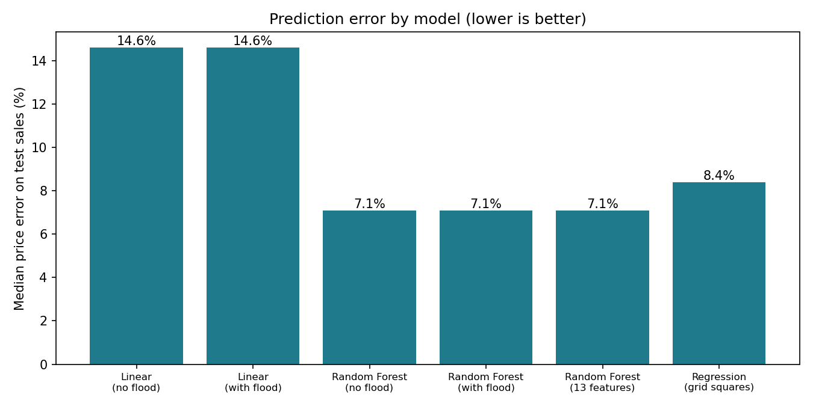
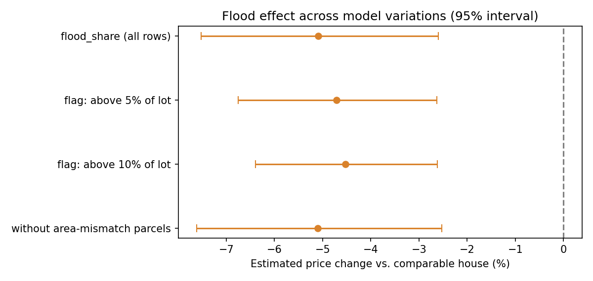

# Flood Zones and House Prices in King County

Does a house in the FEMA 100-year floodplain sell for less than a similar house outside it? This project combines King County Assessor sales data with a King County GIS floodplain layer to find out, and it also trains a model to predict sale prices.

**Tools used:** Python, pandas, GeoPandas, statsmodels, scikit-learn.

## Key findings

- A parcel entirely inside the floodplain sold for about **5% less** than a comparable house (95% interval roughly −7.5% to −2.6%). The estimate stayed between −4.6% and −5.2% across four variations, and was −4.2% when fitted on training rows only.
- A Random Forest predicts sale prices with a typical (median) error of **7.1%** on a held-out test set (R² = 0.934). A regression with grid-square location controls scores R² = 0.930 and 8.4% on the same test sales.
- Flood exposure barely changes overall prediction accuracy, because only 1.7% of homes (1,870 of 107,924) overlap the floodplain.
- This is an **association, not proof of cause**. The floodplain layer is labelled a *pending* FEMA map, and King County states it is not for parcel-level determinations.

## Data

The raw data is **not included** in this repository because the files are large. Download it yourself:

| Source | Files | Where |
|---|---|---|
| King County Assessor | Real Property Sales, Residential Building, Parcel and LookUp (CSV), plus the Real Property Sales layout document | King County Assessor "Data Download" page |
| King County GIS Open Data | "Parcel" layer (639,343 parcels, shapefile) | gis-kingcounty.opendata.arcgis.com |
| King County GIS Data Catalog | "fema floodplain 100 yr area" (shapefile) | www5.kingcounty.gov/sdc/ |

Put the files in a local `data/` folder (Git ignores it). Check King County's terms and conditions before sharing the data or anything derived from it: https://kingcounty.gov/en/dept/kcit/data-information-services/gis-center/about/terms-conditions-copyrights

## Method in brief

1. **Extraction.** Assessor bulk CSVs and two GIS shapefiles. Codes decoded with the Assessor's lookup table and layout document.
2. **Cleaning.** Sales from 2022 onward, single-family homes, normal sale reasons, warranty-type deeds, no red-flag sale warnings, single-building parcels, duplicates and impossible records removed. 241,434 sales narrowed to 107,924.
3. **Flood integration.** Parcel polygons overlaid on the dissolved floodplain (EPSG:2926). `flood_share` is the fraction of each parcel inside the floodplain.
4. **Features.** Log price, living area and lot size, age, bathrooms, grade, condition, views, waterfront, sale timing, parcel-centroid coordinates and one-mile grid squares.
5. **Feature selection.** Variance inflation factors, then permutation importance on a validation slice of the training data. 13 features kept, with `flood_share` retained as the research variable.
6. **Models.** OLS regression for the flood effect (clustered standard errors) and a Random Forest for prediction.
7. **Verification.** 80/20 random split (`random_state=42`): about 86,339 training and 21,585 test rows. All reported accuracy figures are on the test set.

Full detail is in the `docs/` folder.

## Results at a glance

| Model | Test R² | Median error |
|---|---|---|
| Linear regression (coordinates only) | 0.804 | 14.6% |
| Regression with grid squares and sale quarter | 0.930 | 8.4% |
| Random Forest (13 selected features) | 0.934 | 7.1% |

| Flood estimate (regression) | Coefficient | 95% interval |
|---|---|---|
| flood_share, all rows | −0.0522 | −0.0782 to −0.0263 |
| Flag: more than 5% of lot | −0.0483 | −0.0699 to −0.0266 |
| Flag: more than 10% of lot | −0.0463 | −0.0661 to −0.0265 |
| Without area-mismatch parcels | −0.0524 | −0.0792 to −0.0256 |




## Repository layout

```
king-county-flood-house-price/
├── README.md
├── requirements.txt
├── .gitignore
├── data/          # raw data goes here (not tracked)
├── notebooks/     # analysis notebooks, run top to bottom
├── results/       # saved tables and figures
└── docs/          # report (PDF)
```

## How to run

```bash
pip install -r requirements.txt
```

Download the data into `data/` (see above), then run the notebooks in `notebooks/` in order. The overlay and the regression can take several minutes and use a lot of memory.

## Limitations

- The floodplain layer is a pending FEMA map and is informational only.
- The regression shows an association. Unmeasured neighborhood factors may bias it.
- Only 1,870 homes are flood-exposed, so intervals are wide and subgroup results are unreliable.
- House features are today's Assessor records, not their state at the time of sale.
- Several choices were mine: the sale-warning code list, the importance cutoff (0.001), the 5% and 10% thresholds and the grid size.
- The split is random, not by date. A time-based split would be a stricter test.


## Data Sources and Attribution

This project uses publicly available datasets from:

- King County Department of Assessments – Property sales and residential building data.
- King County GIS Open Data – Parcel boundaries.
- King County GIS Data Catalog – fema floodplain 100 yr area.

**Attribution:** Data provided by permission of King County.

Raw datasets are not included in this repository. Users should obtain the original datasets from their respective official sources and review their applicable terms of use.

**Data limitation:** The FEMA floodplain layer represents a pending map and is intended for informational purposes only. It should not be used for parcel-level determinations.

## Author

[Fiza Jaleel] · [12 Nov 2026]